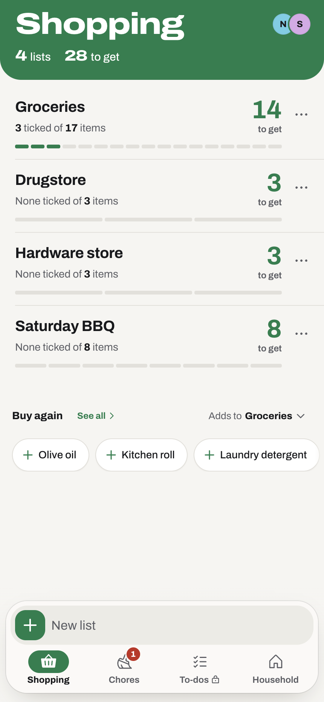
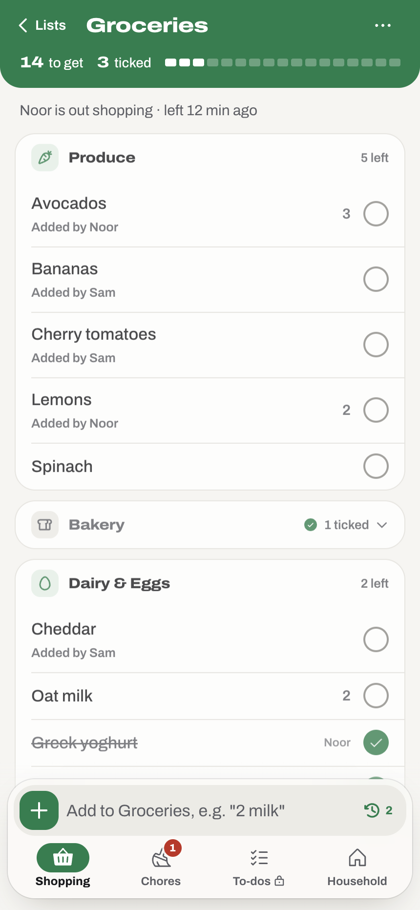
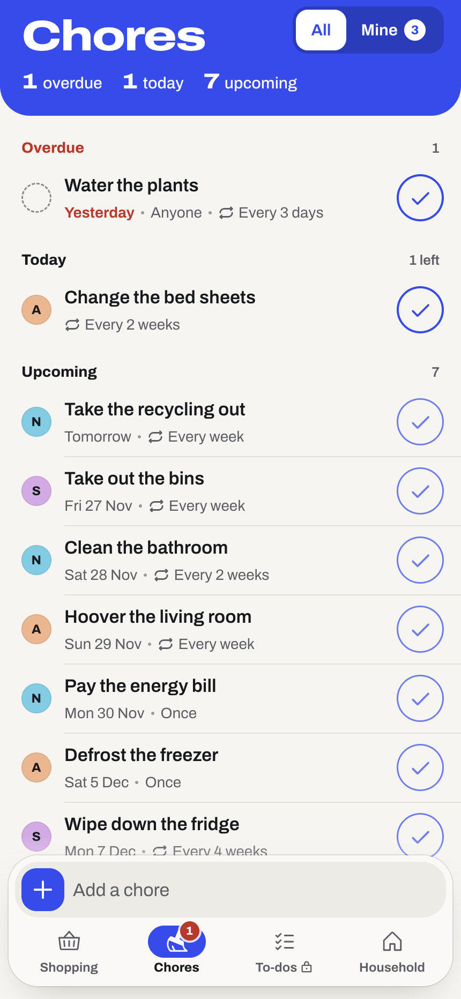
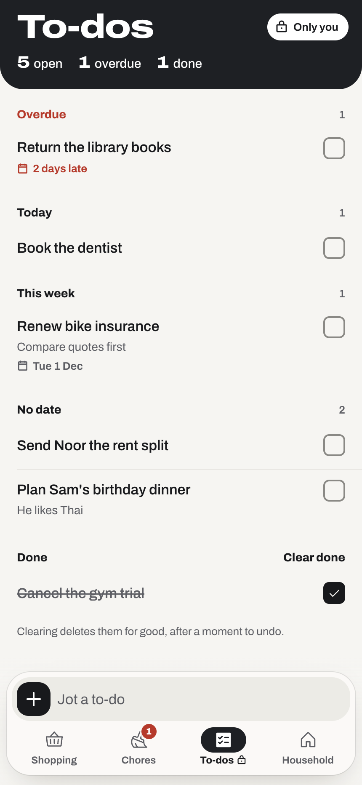
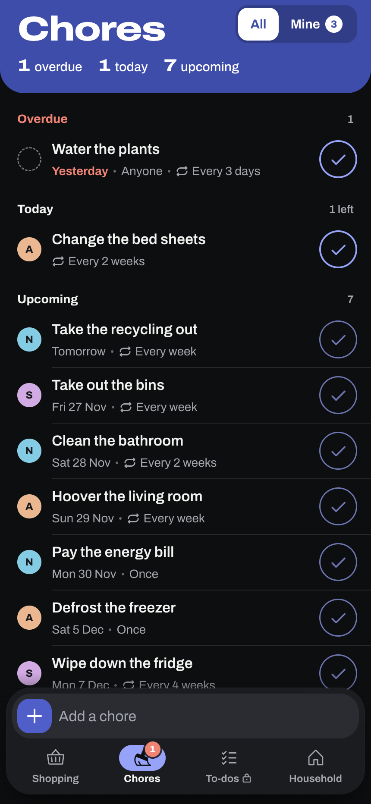

# taskhold

A phone-first, offline-capable PWA for people who share a household: shared shopping lists, repeating chores with push reminders, and private to-dos.

Built as a TypeScript monorepo with a Hono API, Drizzle ORM on PostgreSQL 18, and a Vite + React 19 frontend, deployed as a single self-hostable Docker image.

**[Try the demo →](https://taskhold.lunexa.dev)** No sign-up: you get a household of your own with two made-up housemates and a few weeks of history, deleted after a day. Open it on a phone, or in a narrow window.

| Shopping                                                                                                    | A list                                                                                                                    | Chores                                                                                                    | To-dos                                                                  | Dark mode                                                                          |
| ----------------------------------------------------------------------------------------------------------- | ------------------------------------------------------------------------------------------------------------------------- | --------------------------------------------------------------------------------------------------------- | ----------------------------------------------------------------------- | ---------------------------------------------------------------------------------- |
|  |  |  |  |  |

## What it does

- **Shared shopping lists** — auto-grouped into supermarket aisles, optimistic check-off with undo, "Buy again" suggestions ranked from household purchase history, and live shopping-trip notifications.
- **Repeating chores** — next due date counts from when a chore was done rather than when it was due, with skip/postpone, assignees, completion history, and daily Web Push summaries in each person's time zone.
- **Private to-dos** — visible only to the person who created them, with one-tap promotion into household chores.
- **Households** — 8-character invite codes and shareable join links, automatic ownership transfer on leave, and instant code rotation when a member leaves or is removed.

## Engineering highlights

- **Multi-instance real-time sync:** PostgreSQL `LISTEN/NOTIFY` bridged to Server-Sent Events (`/api/live`). Notifications are sent inside DB transactions so clients never hear about rolled-back writes, and carry only topic names so all data still goes through normal auth checks.
- **Offline-first mutations & idempotency:** Declarative write queue (`defineChange`) persisted to `localStorage` with optimistic UI updates, client-chosen UUIDs so retried creates never duplicate, and versioned schema guards.
- **Concurrency & integrity:** Row-level `FOR UPDATE` locking for household membership transitions, per-identity invite brute-force throttling, and database-claimed daily reminder sends so overlapping runs or multiple instances never double-notify.
- **Defense-in-depth security:** `__Host-` session cookies over HTTPS, same-origin CSRF checks, unused Better Auth endpoints switched off, build-time SHA-256 Content Security Policy Vite plugin, SSRF-hardened Web Push endpoint allowlist with secret-verified device ownership, and trusted-proxy IP chain parsing.
- **Observability & guardrails:** Wide-event canonical JSON logging with Pino (tail-sampled, secret-redacted), end-to-end typed Hono RPC, strict `oxlint` rules (about 170, including import boundaries between layers and features), `knip` dead-code checks, and cross-package architectural invariant tests (`test/repo-invariants.test.ts`).

## Tech stack

| Layer            | Stack                                                                                                                        |
| ---------------- | ---------------------------------------------------------------------------------------------------------------------------- |
| **API**          | Node.js 26 (`Temporal`), TypeScript, Hono, Drizzle ORM, PostgreSQL 18, Zod                                                   |
| **Auth & Push**  | Better Auth (Google OAuth), Web Push (VAPID), Pino wide-event logging                                                        |
| **Web**          | Vite 8, React 19 (React Compiler), TanStack Router & Query, Tailwind v4, shadcn/Base UI, `vite-plugin-pwa`                   |
| **Quality & CI** | Vitest (real Postgres API integration tests + web unit tests), Playwright, `oxlint`, `oxfmt`, `knip`, GitHub Actions, Docker |

## Structure

```
apps/
  api/   Hono on Node, port 3000, routes under /api
         Better Auth (Google) + Drizzle ORM on Postgres
  web/   Vite + React 19 + React Compiler + TanStack Router, port 5173, proxies /api to the API
```

Both apps are organized in feature slices, with routes, services and repos on the API side.

- [docs/features.md](docs/features.md): how each part of the app works (shopping, chores, to-dos, households, reminders, live updates and offline changes)
- [docs/operations.md](docs/operations.md): deploying, security headers, limits and logging
- [docs/development.md](docs/development.md): the typed API client, migrations, tests, CI and scripts
- [ARCHITECTURE.md](ARCHITECTURE.md): the layers, data flow and lint rules in full
- [GLOSSARY.md](GLOSSARY.md): the domain terms
- [AGENTS.md](AGENTS.md): the short contributor map

## Getting started

Requires Node 26+ (for its built-in `Temporal`), pnpm 12 and Docker.

```bash
pnpm install
pnpm db:up        # start Postgres in Docker
cp apps/api/.env.example apps/api/.env
```

Fill in `apps/api/.env`:

- `BETTER_AUTH_SECRET`: generate one with `pnpm --filter @taskhold/api exec auth secret`
- `GOOGLE_CLIENT_ID` / `GOOGLE_CLIENT_SECRET`: create an OAuth client ID (Web application) in Google Cloud Console under APIs & Services > Credentials, with
  - Authorized JavaScript origin: `http://localhost:5173`
  - Authorized redirect URI: `http://localhost:5173/api/auth/callback/google`

Then apply the migrations and start both apps:

```bash
pnpm db:migrate
pnpm dev          # runs api and web in parallel
```

Open http://localhost:5173.

In VS Code, install the recommended Oxc extension to format and lint on save.

The other scripts (tests, migrations, Drizzle Studio) are listed in [docs/development.md](docs/development.md#scripts).

## Demo

With `DEMO_MODE=true`, the sign-in page offers **Try the demo**. `POST /api/demo` signs the visitor in with a throwaway anonymous account (Better Auth's anonymous plugin, whose own `/sign-in/anonymous` route stays switched off) and seeds a household of their own (`features/demo`):

- **"The Flat"**, with two made-up housemates, Noor and Sam, who have no way to sign in. Four lists with Noor out shopping, two months of shopping trips for _Buy again_, ten chores with history (overdue, due today, one-offs), and six private to-dos, all dated from today.
- **Housemate's turn** in the demo banner has Noor tick the oldest item off (or add one), through the shopping service and live updates as a real person's change would arrive.
- **Sealed:** a demo account can't start, join or leave a household or turn on notifications, and nobody can join a demo household with its code. _End the demo_ (Household or Account) deletes it at once; otherwise the API deletes demos after 24 hours (`demo.scheduler.ts`, every 10 minutes).
- **Separate:** each demo is its own household with its own housemates, so the usual household scoping keeps demos apart; a test checks that one demo can't see or change another's.
- **Limits**, counted in Postgres so they hold across instances:
  - five demos at once per client IP (an IPv6 address by its /64), counted by household so signing out doesn't free one (`TOO_MANY_DEMOS`, 429);
  - 500 demo households at once (`DEMO_FULL`, 503). Both are checked before anything is written, and again under a Postgres advisory lock while seeding, so a burst of requests can't slip past them;
  - 1,000 changes per demo (`DEMO_BUDGET_SPENT`, 429), on top of the usual caps. Every change writes at most a couple of rows and no endpoint takes a batch, so one demo stays at a few thousand rows however it's driven. Reading and ending a demo aren't counted.

## Contributing

taskhold is a personal project, but issues and suggestions are welcome. For anything bigger than a small fix, please open an issue before a pull request. [AGENTS.md](AGENTS.md) and [ARCHITECTURE.md](ARCHITECTURE.md) explain the conventions, and `pnpm check` and `pnpm test` must pass. Report security issues privately as described in [SECURITY.md](SECURITY.md).

## License

[MIT](LICENSE)
